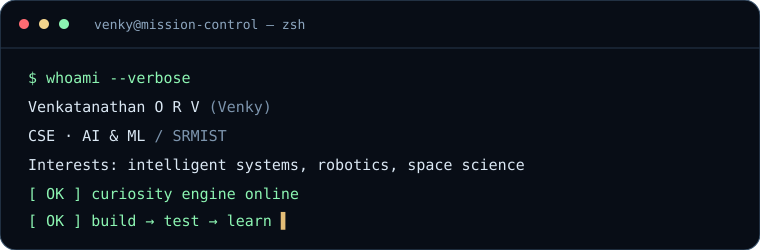

<!-- VENKY.EXE / A profile README designed as a compact mission-control interface -->

  <picture>
    <source media="(prefers-color-scheme: light)" srcset="assets/hero/hero-light.svg">
    
  </picture>

  <a href="#identity">IDENTITY ↘</a>　·　
  <a href="#missions">MISSIONS ↘</a>　·　
  <a href="#research">RESEARCH ↘</a>　·　
  <a href="#stack">STACK ↘</a>　·　
  <a href="#signal">SIGNAL ↘</a>

  <a href="https://github.com/Venkatreacts">⌘ GitHub</a>　·　
  <a href="mailto:vo6649@srmist.edu.in">✉ Email</a>　·　
  <a href="https://noise-trap.vercel.app">↗ Noise Trap</a>

---

## 01 / Identity file

**Computer Science Engineering · Artificial Intelligence & Machine Learning**  
SRM Institute of Science and Technology · 2024–2028

I’m **Venkatanathan O R V (Venky)**, a CSE student interested in the systems where machine intelligence meets the physical world. I enjoy working across machine learning, scientific computing, space-oriented applications, robotics and software engineering.

My favourite loop is simple: **ask a better question → build a model → test it against reality → improve the system.**

  

## 02 / Selected missions

A field log of public work. Project descriptions and technical details below are drawn from the linked repositories.

<table>
  <tr>
    <td width="50%" valign="top">
      01 · SCIENTIFIC COMPUTING / NASA DATA
      <h3>Noise Trap</h3>
      
<strong>Can a detected climate trend survive autocorrelation-aware testing?</strong>

      
A trend-detection app for NASA Earth data that compares the ordinary Mann–Kendall test with pre-whitening and false-discovery control. It includes a global atlas, regional scans, case investigations and an MCP interface.

      
<a href="https://noise-trap.vercel.app">↗ Live field console</a> · <a href="https://github.com/Venkatreacts/astronomy-of-the-arcane">↗ Source repository</a>

      PYTHON · STATISTICS · NASA POWER / GIOVANNI · MCP
      
<small>Repository validation: 32.0% false alarms for the usual test versus 3.8% for the corrected method on the documented sticky-noise simulation.</small>

    </td>
    <td width="50%" valign="top">
      02 · QUANTUM MACHINE LEARNING
      <h3>Q-DRIFT</h3>
      
<strong>Adapt anomaly detection when spacecraft telemetry drifts.</strong>

      
A drift-aware quantum-kernel adaptation study using online drift detection and a candidate encoding library for telemetry anomaly detection. The repository separates proposal material from the later implementation.

      
<a href="https://qdrift-console.vercel.app">↗ Project console</a> · <a href="https://github.com/Venkatreacts/Q-DRIFT">↗ Source repository</a>

      QUANTUM ML · PENNYLANE · ADWIN · TELEMETRY
    </td>
  </tr>
  <tr>
    <td width="50%" valign="top">
      03 · TIME-SERIES MACHINE LEARNING
      <h3>BikeCast</h3>
      
<strong>Explore demand patterns for shared urban mobility.</strong>

      
A Streamlit project for bike-sharing demand analysis with clustering, PCA, HMM states, Kalman forecasting and an ensemble-model leaderboard. Its README documents tests and reproducible model checks.

      
<a href="https://bikecast.streamlit.app">↗ Live demo</a> · <a href="https://github.com/Venkatreacts/bikecast">↗ Source repository</a>

      PYTHON · STREAMLIT · HMM · KALMAN · ENSEMBLES
    </td>
    <td width="50%" valign="top">
      04 · NETWORK SECURITY / SYSTEMS
      <h3>PlaceGuard</h3>
      
<strong>Design a resilient, zero-trust campus placement network.</strong>

      
A two-site Cisco Packet Tracer network with segmented VLANs, VPN transport, firewall controls, management-plane protection and an isolated RFID interview-hall IoT segment. The repository records 11 tested scenarios.

      
<a href="https://github.com/Venkatreacts/PlaceGuard-CN-Project">↗ Source repository</a>

      CISCO PACKET TRACER · NETWORK SECURITY · IPSEC · VLAN
    </td>
  </tr>
</table>

## 03 / Research & exploration

- **Earth-system trend analysis:** Noise Trap investigates how temporal autocorrelation can inflate conventional trend-test confidence, using NASA POWER and Giovanni datasets. Its repository includes validation notes, tests and stated limitations.
- **Quantum machine learning for telemetry:** Q-DRIFT explores drift-aware quantum-kernel adaptation for anomaly detection in spacecraft telemetry. Its repository distinguishes proposal material from measured implementation results.
- **Celestial visualisation:** [Project Zenith – Celestial Eye](https://github.com/Venkatreacts/project-zenith-celestial-eye) is described as a real-time celestial radar for satellites, planets, constellations and space activity.

I’m especially interested in computer vision, explainable machine learning, multimodal systems, robotics and the use of computation to make scientific data easier to interrogate.

## 04 / Engineering toolkit

A working set of technologies and topics represented in my project work and learning profile. This is not a proficiency ranking.

| Discipline | Tools & concepts |
|:--|:--|
| **Programming** | Python · C / C++ · Java · JavaScript · SQL |
| **Machine learning** | scikit-learn · PyTorch · TensorFlow · OpenCV · NumPy · pandas |
| **Scientific & time-series methods** | HMM · Kalman filtering · clustering · PCA · ensemble learning · statistical testing |
| **Software & interfaces** | Streamlit · React · REST APIs · Git · GitHub |
| **Systems & networks** | Linux · Cisco Packet Tracer · VLANs · IPsec · network security |
| **Emerging interests** | Quantum machine learning · spacecraft telemetry · robotics · astronomy |

## 05 / Signal & telemetry

  
  

  <picture>
    <source media="(prefers-color-scheme: dark)" srcset="https://raw.githubusercontent.com/Venkatreacts/venkatreacts/output/github-contribution-grid-snake-dark.svg">
    <source media="(prefers-color-scheme: light)" srcset="https://raw.githubusercontent.com/Venkatreacts/venkatreacts/output/github-contribution-grid-snake.svg">
    
  </picture>

Stats are supplied by an external widget; contribution art is generated by the profile repository workflow. The profile and repositories remain the source of truth.

## 06 / Outside the lab

Astronomy · Space exploration · Physics · Chess · Robotics · Scientific experimentation

  <a href="mailto:vo6649@srmist.edu.in">✉ Start a conversation</a>　·　
  <a href="https://github.com/Venkatreacts">⌘ Explore the repositories</a>

VENKY.EXE · BUILD WITH CURIOSITY · KEEP LOOKING UP
